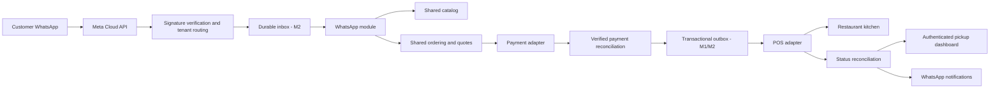

# Architecture and deployment

## Runtime boundaries

Use one TypeScript modular monolith for a two-person team. The current server is Fastify on Node 24. Shared domain services own business decisions; transport handlers translate payloads. Both Toteat and Fudo are first-pilot adapters, configured separately per restaurant/branch, with the selected provider snapshotted on each order. A provider API does not define the application's domain model.

Only WhatsApp ordering is enabled for the demo tenant; QR is disabled. Future QR, web ordering and loyalty use shared services and events, never depend on an enabled WhatsApp service. Entitlement changes control access to services, not ownership/deletion of catalog or order data.

## Original prototype and durable extension

- `platform/domain.ts`: demo tenant, catalog, session/cart and order snapshots. One process-local repository.
- `platform/ordering.ts`: confirmation, simulated payment/POS and allowed operational transitions.
- `modules/whatsapp/conversation.ts`: deterministic Spanish text flow and per-customer serialization.
- `integrations/contracts.ts`: typed `PaymentProvider`, `PosProvider`, `WhatsAppTransport` and labeled demo adapters.
- `integrations/whatsapp.ts`: Cloud API sending, raw-byte signature helper and mapped-message normalization.
- `app.ts`: schema validation, bearer-protected demo APIs, static asset allowlist, security headers and webhook ingress.

In the original memory mode, demo duplicate detection and mock POS idempotency work only within a process lifetime. WhatsApp delivery currently happens before the webhook returns; failures receive 5xx and replay reuses the cached domain reply. This is intentionally a test-account scaffold. Restart-safe ingress, distributed concurrency and delivery ambiguity need #6/#8/#10. Memory Maps have no retention pruning beyond session expiry on access; use test data only. The current mock provider cannot exercise real provider timeout ambiguity or financial correctness.

The browser UI uses native HTML/CSS/JavaScript and semantic forms. It sends a page-memory bearer token, uses text-only DOM insertion, and makes no automatic third-party requests. Its local key is temporary demo access, not the owner/staff identity system. All demo order endpoints are isolated under `/api/demo`. A deployed pilot must use real staff authentication and disable all simulation mutations.

UI language defaults to Spanish and supports explicit English selection; the browser stores only that preference and updates document `lang`, labels, accessible names, error text and number/date presentation. Chat locale is conversation-scoped; explicit language commands work in WhatsApp. Catalog snapshots include Spanish and English names, while item IDs and CLP totals stay stable across language changes. Persist these preferences/translation fields in the durable model; do not infer a customer's identity from the selected language.

## Durable model to implement in M1/M2

Use PostgreSQL with tenant-scoped foreign keys and unique keys. Every query includes authenticated tenant and branch, derived from staff identity or mapped provider account, never from customer-supplied text. Verify isolation with negative tests; consider RLS as defense in depth once connection-pool context handling is designed.

| Entity | Important invariants |
| --- | --- |
| tenants / branches / memberships | Timezone, currency, role, entitlements and mapped provider phone IDs |
| products / modifiers / provider mappings | Authoritative provider IDs, availability, integer CLP prices and catalog version |
| conversations / carts / quotes | Tenant + sender; expiry; immutable displayed quote with catalog version |
| orders / order_lines | UUID, source=whatsapp, confirmed snapshot, tenant/branch, explicit operational state |
| payment_attempts / payment_events | Unique merchant reference and provider event ID, amount/currency, verified status, refund ledger |
| pos_submissions | External reference, provider reference, attempt/status and unknown-outcome marker |
| inbox / outbox / deliveries | Unique tenant + provider + event ID, claim lease, retry count, backoff and dead-letter reason |
| order_events / audit | Append-only state changes with actor and correlation ID; no raw secrets/messages |

Store UTC timestamps; derive restaurant-local dates using `America/Santiago`, including daylight-saving changes. Use CLP integer minor-unit convention verified for the gateway (CLP normally has no fractional price component); never floating-point prices or browser-submitted totals. Do not overload order status with financial state.

## Payment and fulfillment contracts

1. Price/availability/hours are checked and a quote displayed. On confirm, validate the quote/version and freeze line items. A changed price requires renewed customer confirmation.
2. Create or recover a checkout for that immutable order and merchant. Set an expiry and unique correlation reference.
3. An authenticated provider callback and/or authoritative status lookup verifies amount, currency, merchant, reference and settled/approved status. A browser redirect proves nothing about payment.
4. In one transaction, record the verified payment and enqueue a POS submission. The customer sees payment received while acceptance remains pending.
5. The POS adapter checks the shift/menu mappings and submits the paid pickup. Persist provider references and acceptance independently. Only confirmed kitchen acceptance changes fulfillment state.
6. Reconcile callbacks/polling and notify accepted/ready states under WhatsApp messaging rules. Staff confirms collection with audit.
7. A paid order that cannot be accepted enters `needs_attention`; a named operator resolves it or refunds. Reconcile payment/POS ledgers daily.

For timeouts: check by external reference before retrying. Provider idempotency must be demonstrated, not inferred from a local unique key. Without an authoritative lookup/idempotency guarantee, require staff reconciliation rather than risking a second kitchen order. Queue processing is at-least-once; application side effects must tolerate replay.

## Regional deployment target

Use Google Cloud **Santiago (`southamerica-west1`)** for Cloud Run and Cloud SQL PostgreSQL. Cloud Run lists the region in its [location documentation](https://docs.cloud.google.com/run/docs/locations); verify the required Cloud SQL edition, machine types, queue and other product availability/cost at deployment time. [Cloud SQL locations](https://docs.cloud.google.com/sql/docs/postgres/locations) is the source of truth.

Deploy a web/ingress service and a worker from the same codebase; select managed durable queue execution after checking regional availability (#19). Database is private, secrets are stored in Secret Manager, and service identities have least privilege. Maintain staging/production separation, HTTPS, webhook access paths, restricted authenticated admin access, migration/rollback steps and backup restore evidence. Real provider API calls stay server-side. Static assets can be cached regionally later; tenant data must never be publicly CDN-cached.

No cloud resource is provisioned by this setup. The included Dockerfile runs the **simulation**, for local/staging demonstration only. Durable storage and real adapter modes must land before real payments. Webhook availability alone is not pilot readiness.

## Observability and required verification

Log correlation IDs, order IDs, provider outcome class, latency and retry count. Exclude message bodies, customer identifiers, credentials and checkout URLs. Alert on paid-but-unaccepted backlog, dead letters, provider errors and stale status sync. Test duplicates/concurrency, restart recovery, tenant isolation, price changes, forged callbacks, mismatched payment amounts, unknown POS outcomes, refunds and local-date metrics. Keep automated tests small and focused on these failure boundaries.

## PostgreSQL and access implementation (#6)

Optional PostgreSQL mode now implements transactional restaurant/branch repositories, migrations/seed, scoped staff tokens/roles, durable sessions/orders/line snapshots/payment references, inbox/outbox and audit records. See [the storage and access design](postgres-storage.md) for setup, isolation guarantees, restart tests and limits. Asynchronous messaging workers, quote/version contracts and real-provider financial reconciliation remain separate issues.

## Catalog and availability extension (#7)

The shared catalog now supports manual reviewed imports, product/modifier mappings for both providers, stock/shift/hours gates and persisted versioned quotes. See [catalog behavior and remaining provider gates](catalog-and-availability.md). Customer confirmation cannot silently accept a changed or expired quote. Verified provider ingestion remains #2/#13/#22; #7 stays open for its external acceptance evidence.
