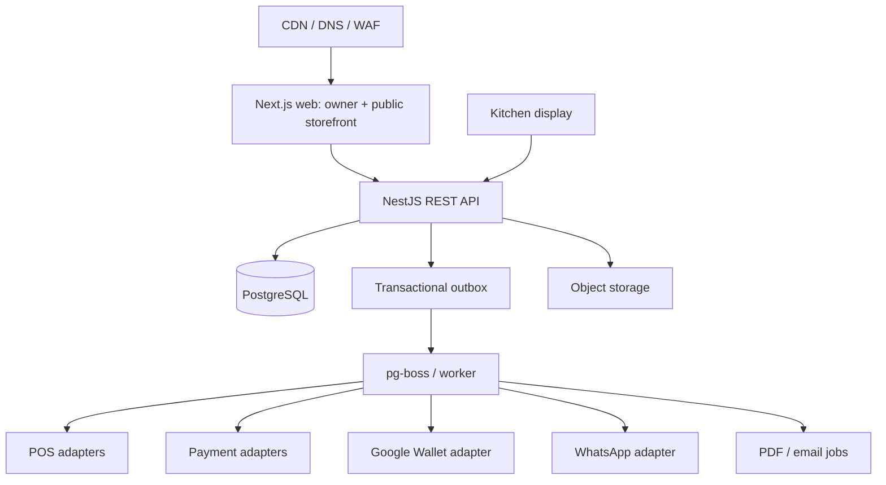

# Shared Platform Architecture

## 1. Architectural decision

Use a **TypeScript monorepo with a modular monolith**, PostgreSQL as the system of record, a PostgreSQL-backed job queue/outbox, and a single regional deployment. Modules have explicit domain boundaries but share a database and deployment initially. Split into services only when an independently scaling/operating requirement is demonstrated.

## 2. Common stack (all modules)

- **Language:** TypeScript end-to-end for application code.
- **Monorepo:** `pnpm` workspaces + Turborepo (or pnpm alone if Turborepo adds friction).
- **Public/admin web:** Next.js App Router, React, TypeScript.
- **UI:** Tailwind CSS + shadcn/ui/Radix; shared tokens and accessible components.
- **Forms/validation:** React Hook Form + Zod; server validates every payload independently.
- **API:** NestJS REST API (clear module boundaries, DI, guards, OpenAPI generation). Use REST for stable internal/public contracts.
- **Database:** managed PostgreSQL. Prisma for normal CRUD and migrations; allow reviewed SQL for reports/locking when required. Never let Prisma model design replace explicit database constraints.
- **Jobs:** `pg-boss` or an equivalent PostgreSQL-backed queue. Use one implementation; do not add Redis just for jobs in MVP.
- **Real-time:** Server-Sent Events (SSE) for kitchen/order status. Start with polling fallback. WebSocket is not required unless bidirectional interactive features prove necessary.
- **Files:** Google Cloud Storage (signed URLs for private files) or equivalent S3-compatible object storage.
- **Auth:** start with a mature hosted/managed auth provider or a well-maintained auth library; enforce tenant+branch membership server-side. Pick one and document the trade-offs before coding. Never DIY password/session cryptography.
- **Tests:** Vitest/Jest for unit/integration; Playwright for end-to-end; provider sandbox contract tests.
- **Observability:** structured JSON logs, error tracking, uptime monitoring, key domain metrics and redacted integration request IDs.

## 3. Repository layout

```text
apps/
  web/                 # Next.js owner dashboard and public storefront
  api/                 # NestJS REST API
  worker/              # job/outbox processors, same domain packages
packages/
  ui/                  # shared accessible UI components and design tokens
  config/              # eslint, tsconfig, test config
  contracts/           # Zod schemas, event types, API DTOs
  domain/              # entities, use cases, policies, module registry
  integrations/        # provider interfaces and adapters
  localization/        # es-CL labels, formatting and messages
  testing/             # fixtures, factories, test helpers
docs/
  specs/ decisions/ runbooks/
prisma/                # schema and migrations (or package-local schema)
```

Use import boundaries so modules cannot directly depend on another module's internal implementation. Cross-module behavior should use public application services or versioned domain events.

## 4. Logical architecture



## 5. Bounded contexts/modules

- `platform`: tenants, branches, users, roles, audit log, feature/module entitlements, support metadata.
- `catalog`: menus, categories, items, modifiers, prices, availability, source-of-truth flags and catalog imports.
- `orders`: cart validation, order lifecycle, item snapshots, pickup slot, kitchen state.
- `payments`: payment attempts, provider references, webhook inbox, reconciliation, refunds.
- `loyalty`: accounts, immutable ledger, rules, redemption, reversal, pass sync status.
- `crm`: customer identity aliases, profiles, consent purposes, visit/transaction aggregation, segments.
- `messaging`: templates, conversation state, outbound campaign, delivery events and suppression.
- `catering`: event inquiry, pricing rules, quote versions, PDF artifacts, lead lifecycle.
- `integrations`: connection credential references, provider capabilities, sync runs, webhook inbox/outbox.
- `billing`: platform subscriptions, entitlements, usage events and invoices/charges; do not conflate with restaurant order payments.

## 6. Dependency rule

Feature modules may require shared capabilities, but not another commercial module's UI or controller. Example: pickup ordering uses `catalog` + `orders`; it does not call `qr-menu`. QR is a presentation/channel over the same catalog. WhatsApp ordering calls the same order application service as web pickup. Catering uses `lead-records` but not the general CRM campaign UI.

Each module declares:
- required capabilities;
- optional integrations;
- routes/pages it contributes;
- data tables it owns;
- event types it publishes/consumes;
- tenant entitlement key;
- health checks and setup checklist;
- disable/deletion behavior.

## 7. Tenancy and identity

- `tenant_id` on every tenant-owned root/record; `branch_id` where an operation is branch-specific.
- UUID/ULID internal identifiers; do not expose sequential database IDs publicly.
- Resolve tenant context from authenticated membership or unguessable public slug; never trust a client-supplied `tenant_id` alone.
- Add composite unique constraints including `tenant_id` for tenant-scoped slugs/external provider IDs.
- Consider PostgreSQL RLS as defense in depth, but still scope every query and use least-privilege DB roles.
- Tenant timezone/currency are configuration fields; for Chile default timezone is `America/Santiago`, currency `CLP`.

## 8. API standards

- REST `/api/v1/...`; OpenAPI generated and checked into CI.
- Use Zod DTO schemas from `packages/contracts` or generate clients from OpenAPI; avoid duplicate schemas drifting.
- Error envelope `{ code, message, requestId, details? }`; do not leak provider payloads/secrets.
- Idempotency key on operations that create orders, payment attempts, redemptions, quotes where appropriate, and outbound messages.
- Pagination is cursor-based for high-volume resources.
- Rate-limit public endpoints and webhook endpoints separately.
- All time instants stored as `timestamptz`; render in `America/Santiago`.
- Store CLP amounts as integer pesos; never use floating point for currency.
- Currency code is always explicit, even when CLP is tenant default.

## 9. Data and event consistency

Use a transactional outbox: the domain transaction writes both business state and an outbox row. Worker delivery is at-least-once; consumers must be idempotent. Keep processed provider webhooks in a deduplicated inbox. Do not attempt distributed transactions across POS/payment/Wallet/WhatsApp systems.

Examples: `order.confirmed.v1`, `payment.succeeded.v1`, `payment.refunded.v1`, `pos.sale.imported.v1`, `loyalty.points_earned.v1`, `quote.accepted.v1`, `campaign.delivery_updated.v1`.

## 10. Deployment topology for first customers

- `web`: Cloud Run service in `southamerica-west1` (Santiago), public storefront/admin UI.
- `api`: Cloud Run service in `southamerica-west1`.
- `worker`: Cloud Run service/job in `southamerica-west1`; concurrency and max instances constrained to avoid overwhelming PostgreSQL/provider rate limits.
- Cloud SQL for PostgreSQL in `southamerica-west1`; same region as API/worker.
- Cloud Storage regional bucket; verify data location/backup behavior.
- Cloudflare for DNS/CDN/WAF if useful; public static images can be cached, never private customer/checkout responses.
- Secret Manager for provider credentials.
- CI builds immutable container images; separate dev/staging/prod projects/environments where practical.

Google documents Cloud Run and Cloud SQL locations for Santiago. Availability of each specific ancillary service (scheduler, storage, secret manager and monitoring) must be checked during deployment design. AWS announced Chile region plans for end of 2026, but do not assume it is production-available until the official region/service matrix says so.

## 11. What not to build yet

No microservices, Kafka, Kubernetes, Elasticsearch, graph database, Redis, separate analytics warehouse or SpacetimeDB in the initial architecture. PostgreSQL plus reviewed SQL is enough for transactional and early reporting workloads. SSE serves live kitchen updates.

## 12. Architecture acceptance criteria

- Each module can be entitlement-disabled in tests without disabling other modules.
- Cross-tenant access tests fail closed.
- All money-related state transitions use database transactions and integer CLP.
- Outbox failure/retry/replay is tested.
- Database migration and rollback/forward-recovery policy is documented.
- API schema and migration checks run in CI.
- One scripted deployment provisions staging and smoke-tests it.
